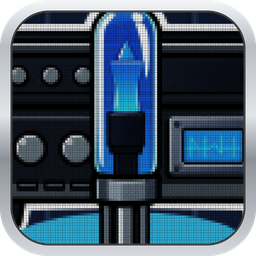
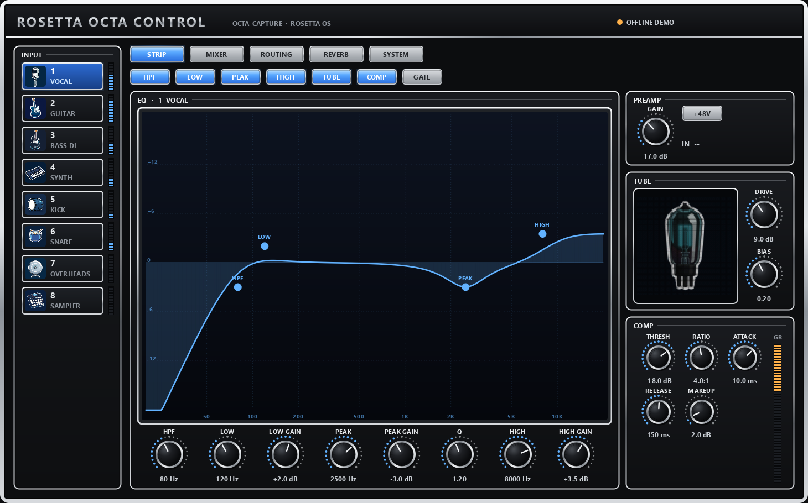
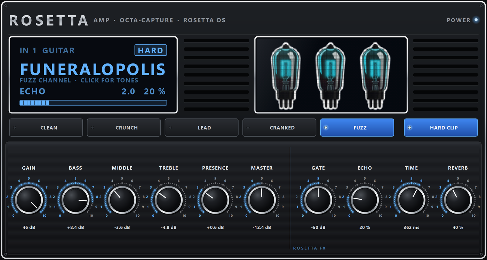
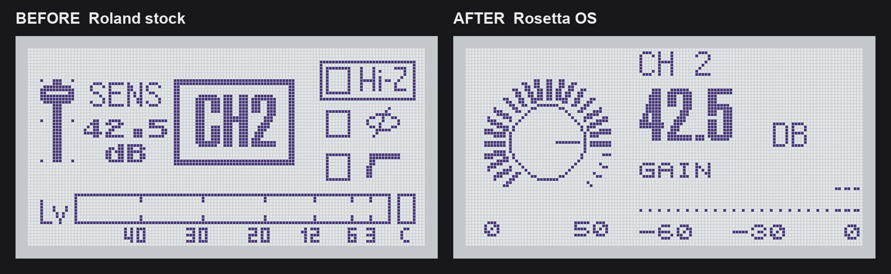

# OCTA-CAPTURE Rosetta OS: the Roland OCTA-CAPTURE mod (custom firmware, channel strip DSP, Rosetta Octa Control app)

A free custom-firmware project for the **Roland OCTA-CAPTURE (UA-1010)** USB audio interface, also written Octa Capture or OctaCapture.
It runs on real hardware: the **Rosetta boot screen**, a per-channel **channel strip** (HPF, tube, 3-band EQ, comp)
running on the unit's own DSP, new LCD pages, and **Rosetta Octa Control**, a PC editor that replaces Roland's Control Panel.
Landing page: [yuyoi.github.io/octa-capture-rosetta-OS](https://yuyoi.github.io/octa-capture-rosetta-OS/).

**What's inside the OCTA-CAPTURE.** One Analog Devices **Blackfin** DSP (a BF52x) runs everything in software:
- the 8 per-channel compressors, the 4 direct mixers and the reverb;
- USB audio, both ways.

This repo cracks open its update file:
- the packing (LZSS with a zero-filled ring);
- the checksums (16-bit byte sums);
- the boot flow and which flash areas an update writes.

It also gives you tools to unpack it, patch it and pack it back. Everything is built from **your own copy of Roland's v1.51 update**, so there's no Roland code in this repo.

> **Made by JunkSmithWizard (JSW) together with Claude (Anthropic's AI).**
> - **Claude:** the reverse engineering (Blackfin disassembly, the update format, checksums, boot flow and flash safety map) and the tools.
> - **JSW:** flashed it on a real OCTA-CAPTURE, picked the art, and steers where it goes next.
>
> Part of the Rosetta line: [D-110](https://github.com/yuyoi/D110-rosetta-OS-v11), [S2000](https://github.com/yuyoi/Akai-S2000-Rosetta-OS), [SP-808](https://github.com/yuyoi/Sp-808-rosetta-looper-OS-) and more.
> Questions, hardware reports and ideas: **[Discord](https://discord.gg/R3CQkFdRtf)**.

## Rosetta Octa Control (PC app)

A PC editor for the OCTA-CAPTURE running Rosetta OS, styled after the unit's front panel (black, silver rim, blue-lit buttons):
- **Named inputs with pictures:** VOCAL, GUITAR, KICK ... with built-in stickers or your own PNG (double-click an input).
- **EQ you drag:** HPF, low shelf, peak, high shelf, drawn with the exact maths the unit's DSP runs.
- **Tube** (glows brighter with DRIVE) and **compressor** with the unit's real gain-reduction meter.
- **Preamp gain + 48V** through Roland's own protocol (decoded in [re/CTRL_PROTOCOL.md](re/CTRL_PROTOCOL.md)), live input meters.
- **Rosetta amp head** for guitar: CLEAN / CRUNCH / LEAD / CRANKED / FUZZ channels, HARD CLIP, GAIN-BASS-MIDDLE-TREBLE-PRESENCE-MASTER, and a ROSETTA FX section (GATE, ECHO, TIME, REVERB). It runs in the box's DSP, not on the PC, so it adds no delay.
- **Patches for mic and guitar:** tap PATCH on the strip page. Five big tabs (MIC, SINGERS, GUITAR DI, GUITAR AMP, YOURS); a tap loads the patch on the spot.
  - MIC (Sennheiser e935), 30: sung vocals (E935 VOCAL, CLEAN TENOR, BARITONE, GOTHIC CROON, CHOIR ...), heavy vocals (SCREAM, GROWL, SHRIEK, LOW GUTTURAL, SHOUT, PUNK SNOT), spoken (TALK, BROADCAST, STREAM VOICE, INCANTATION), effects (RADIO, TELEPHONE, DIST VOX) and the mic on instruments (CAB MIC, ACOUSTIC MIC, HARMONICA, SNARE, TOM, BASS CAB, HORN).
  - SINGERS, 16: OZZY (Sabbath, Blizzard), MAYNARD (clean, dirt, megaphone, whisper), KYUSS GARCIA, WIZARD OBORN, STALEY, CORNELL, HETFIELD (Puppets, Black), ANSELMO, STEELE, MUSTAINE, DANZIG. Each is built from what is on record about the record's vocal chain (mic, compressor, doubling, delay/reverb), with the e935 EQ'd toward that mic. Sources are in [docs/VOCAL_PATCHES.md](docs/VOCAL_PATCHES.md).
  - Patches can bring the box's echo + reverb (the FX key on the strip, one input per box): doubles, slapback, tape echo, rooms.
  - GUITAR DI (amp off), 27: per guitar (LES PAUL, SINGLE COIL, P90, HOLLOW BODY, 7-STRING, BARITONE, 12-STRING, ACOUSTIC piezo), per style (CLEAN, TWANG, FUNK, SLIDE, SUSTAIN, AMBIENT, DROP TUNED), pedals and dirt (PEDALBOARD, FUZZ PEDAL, TUBE DIRT, LO-FI), four for bass, REAMP DI and FLAT.
  - GUITAR AMP, 30 tones: cleans (GLASS, JAZZ, SPRING SURF, FUNK, COUNTRY SLAP, AMBIENT WASH, DOOM CLEAN), crunch (BLUES BREAK, BLUES LEAD, INDIE, POST ROCK, PLEXI, ARENA ROCK, PUNK, GRUNGE) and heavy (80S METAL, SHRED, NU METAL, DJENT, CHAINSAW, BLACK METAL, STONER, SHOEGAZE, DRONE and the first six). All are levelled to the same peak in the C model of the box.
  - Save as many of your own as you like on the PC. The preamp gain is never touched.
  - The gate and FX parts need test/strip10; on older firmware the app says so on the keys.
- **DSP bar:** shows live how much of the box's DSP is in use. It refuses an add that would go past 80 % ("FULL · REMOVE SOMETHING"), and its task list switches anything off with one X.
- **Touch-friendly:** 40 px buttons and big EQ nodes you can grab from a finger-width away. Slide sideways off a knob for fine steps. Hold an input for its menu.
- Mixer and routing pages and a scene-bank panel are next.

- **One-tap REC.**
- **MIC** button: corrects an input for its microphone ([docs/MIC_COMP.md](docs/MIC_COMP.md)).
- **MONITOR OTHER BOX** and **AMP** buttons. Monitoring two boxes is its own topic, because anything through the PC has delay: [docs/MONITORING.md](docs/MONITORING.md). How the amp works: [docs/AMP.md](docs/AMP.md).

Run: `python app/rosetta_control.py` (Python 3, `PySide6`, `mido`, `python-rtmidi`; close Roland's Control Panel first).
It needs a Rosetta lab build on the unit. `--demo` runs it without a unit.

<i>The unit's own Channel page, before and after: pixel-exact grabs of its screen memory.</i>

## Status

| Feature | Status |
|---|---|
| **Rosetta boot screen**: Hex Girl peeking over ROSETTA, 128x64, with the boot bar along the bottom | ✅ on hardware, two units |
| **Update-file tools**: unpack, pack, checksum fix (`octa_fw.py`) | ✅ on hardware (the boot screen was flashed with them) |
| **One-command build** from Roland's v1.51 zip (`tools/build_rosetta.py`) | ✅ rebuilds the tested file byte for byte |
| **Lab backend**: read, write and run code on the live unit over USB-MIDI, no reflash per experiment (`tools/octa_lab.py`, [docs/LAB.md](docs/LAB.md)) | ✅ on hardware |
| **CPU-load meter**: how much DSP is free | ✅ on hardware (stock load ~39 %) |
| **Channel strip** on all 8 inputs, own settings each: gain → HPF → tube → low/peak/high EQ → comp → limiter ([docs/STRIP.md](docs/STRIP.md)) | ✅ on hardware (test builds), measured by loopback |
| **STRIP page** on the LCD (replaces AUTO-SENS) and the **Rosetta Channel page** (knob, big gain in dB, VU) | ✅ on hardware (test builds) |
| **Fast audio path**: the strip runs from the DSP's fastest memory, empty inputs are skipped; a full input costs 677 cycles a sample (was 1,003) | ✅ on hardware |
| **Rosetta Octa Control** PC app: strip editor, named inputs, preamp gain/48V, meters, live DSP bar, touch-friendly | ✅ on hardware |
| **One-tap recorder** in the app: every input on two boxes over our own USB path, retimed onto one timeline | ✅ on hardware (sample-exact sync between boxes not yet proven) |
| **USB monitoring** between two boxes through the PC, about 15 ms ([docs/MONITORING.md](docs/MONITORING.md)) | ✅ on hardware, needs libusbK |
| **Guitar amp** in the firmware: two gain stages, tone stack, speaker; 5 channels incl. FUZZ, the amp head in the app, 6 factory tones + your own ([docs/AMP.md](docs/AMP.md)) | ✅ on hardware |
| **HARD CLIP**, **noise gate** (opens on the same sample, no lookahead), **ROSETTA FX** echo (up to 1.36 s) and reverb: the dry sound stays on time | 🧪 built (test build strip10) and host-tested under AddressSanitizer, not on hardware yet |
| **Scenes on the box**: DISPLAY opens a BANK of 16 whole-box scenes plus TEMP, which is saved with Roland's own power-off save; through Roland's flash driver only ([docs/SCENES.md](docs/SCENES.md)) | 🧪 built (strip10) and host-tested, not on hardware yet |
| **Hi-Z on the Rosetta Channel page** (VALUE push), so both units can use the knob page | 🧪 built (strip10), not on hardware yet |
| **Settings that survive a power cut**: chains, gains, Hi-Z and routing come back by themselves, and the app reconnects after the boxes restart | 🧪 built and tested off-hardware, not yet on the boxes |
| **Mic compensation**: fit the EQ to a mic's published curve, towards flat or towards another mic ([docs/MIC_COMP.md](docs/MIC_COMP.md)) | 🧪 built and tested off-hardware, not yet on the boxes |
| Scene bank panel, mixer/routing pages in the app, gate threshold knob on the strip page | 🚧 next |
| **Solo mode**: fewer active channels, more DSP each (multiband comp, de-esser, delay) | 🚧 planned |
| **Clip guard** in place of AUTO-SENS: preamp gain steps down near clipping and the same gain is added back digitally, so the monitor level stays put | 🚧 planned |

Only the ✅ rows have run on a real unit. The one-command build below still makes the boot-screen release; the strip runs on the lab test builds for now. See [ROADMAP.md](ROADMAP.md).

## Build and flash

1. Download Roland's **OCTA-CAPTURE System Program Ver.1.51** (`octa_sys_v151.zip`) from Roland's support site.
2. Run `python tools/build_rosetta.py octa_sys_v151.zip`. You need Python 3, `numpy` and `Pillow`. It writes `UpdOcta.dat` and checks it.
3. Flash it with Roland's own procedure: hold **[▶] in the PRE-AMP section** and **push the CURSOR/VALUE knob** while powering on. Copy the file to the disk that appears, then unplug.

**Before copying, the updater screen must not show `[ALL]`.** Full steps and recovery: **[docs/FLASHING.md](docs/FLASHING.md)**.
To go back to stock, flash Roland's original `UpdOcta.dat` the same way.

Your own splash: `--splash my_128x64.png` (white = ink). `tools/rosetta_variant.py N` renders any of the 12 framings on [the candidates sheet](art/rosetta_splash_candidates.png).

## How it works (short)

- **Update file:** `UpdOcta.dat`, 1 MB, maps 1:1 onto the unit's flash:
  - booter 0x0
  - loader 0x1000
  - updater 0x4000 (LZSS)
  - main program 0x20000 (LZSS)
  - settings in the last 64 KB, which an update never touches.
- **Checksums:** a 16-bit byte sum at the end of each region. The loader checks them at every power-on, and a bad main sum starts the updater by itself. Full write-up: [CHECKSUM_NOTES.md](CHECKSUM_NOTES.md).
- **The boot picture:** bitmap resource 0xF5, 1 KB. It isn't stored flat. The program's data is built at boot from a VisualDSP init table, so `build_splash_main.py` rebuilds those table records. It then replays the whole table offline to prove only the picture changed. Three tiny code patches hide the version text and move the bar to the bottom. Plan: [re/BOOT_SCREEN_PLAN.md](re/BOOT_SCREEN_PLAN.md).
- **Flash safety:** which combo selects which update mode, what each mode writes, and the one case buttons can't recover. See [re/FLASH_SAFETY.md](re/FLASH_SAFETY.md).

## Walls we hit

- **Every unpacker gets this LZSS wrong.** The history ring starts full of **zeros**, not spaces. With spaces, the sizes still match, but about 600 bytes come out wrong, so every function prologue decodes as `20 E8` instead of `00 E8`.
- **The checksum hides in plain sight.** The last 4 bytes of each region are `7B 01` (a build number) plus the sum. Brute-forcing CRCs over the "obvious" range finds nothing. Reading the loader's add loop did.
- **The data isn't a flat copy.** The main program builds its RAM data from a compressed init table at boot, with copy, zero-fill and pattern-fill records. Patching the picture means rewriting table records, not bytes at an offset.
- **The update combo is read by the main program, not the boot code.** A patched main that freezes early can't be rescued with buttons. So every patch is checked offline first, and nothing touches code that runs before the button scan.
- **The strings say BF533, the registers say BF52x.** Trust the register map.

## Legal

Not affiliated with or endorsed by Roland Corporation. "Roland" and "OCTA-CAPTURE" are trademarks of their owners.

This repo contains **no Roland code or data**: you build from Roland's own update file, downloaded by you. Flashing custom firmware is at your own risk, so always keep Roland's original `UpdOcta.dat`.

License: MIT (see `LICENSE`).

---

**Thanks for enjoying, and God bless you!** — JSW
